# TunnelGuard — финал ЛЦТ 2026

[](https://github.com/EhimenNathan/tunnelguard-lct2026/actions/workflows/docker.yml)
[](https://github.com/EhimenNathan/tunnelguard-lct2026/actions/workflows/reproduction.yml)

**Обновление 19 октября:** восстановлены 13 кадров СТОП на 200–250 м; провалы подтверждения **24→11**, максимальный провал **1,7→1,0 с**. **46 native-тестов и 14/14 условий качества** пройдены. Полностью обработаны Falcon (4443), квалификация (1510) и новые синтетические записи (1667); три новые записи также полностью проиграны в ROS/RViz без потерь. [Текущая оценка 7/10, ограничения и следующие шаги](docs/SPATIAL_REVIEW_20261019_RU.md) · [парная проверка](https://github.com/EhimenNathan/tunnelguard-lct2026/actions/runs/39197603363) · [полные наборы](https://github.com/EhimenNathan/tunnelguard-lct2026/actions/runs/39200634492).

**Текущая проверенная поставка `cdb39de`:** [Docker/native/GUI — успешно](https://github.com/EhimenNathan/tunnelguard-lct2026/actions/runs/39205365593), [полные наборы — успешно](https://github.com/EhimenNathan/tunnelguard-lct2026/actions/runs/39200634492). **46 Linux-регрессий**, 40 локальных Windows (5 пропусков требуют Linux/ROS), 12/12 проверок управления. Точные неизменяемые digest и хеши исходников/моделей: [reproduction_lock.json](docs/reproduction_lock.json). Старые письма об ошибках относятся к предыдущим отклонённым запускам.

**Лидарная система обнаружения препятствий в габарите поезда.** Гибрид геометрии, физики, ML и временного накопления; ROS 2 Humble, RViz, C++17/Numba, Docker с рабочим столом в браузере. Документация, демонстрация и интерфейс — на русском.

| Материал | Финал — текущий этап | Квалификация — историческая версия |
|---|---|---|
| Сайт | **[Открыть новый сайт](https://ehimennathan.github.io/tunnelguard-lct2026/)** | **[Открыть сайт отбора](https://ehimennathan.github.io/tunnelguard-lct2026/qualification.html)** |
| Видео | **[Все наборы и 68 инъекций, 1080p](https://ehimennathan.github.io/tunnelguard-lct2026/assets/tunnelguard_all_datasets.mp4)** · [только три новые записи](https://ehimennathan.github.io/tunnelguard-lct2026/assets/tunnelguard_final.mp4) | Предыдущие материалы сохранены в истории |
| Запуск | **[Пошагово на другом ПК](docs/RUN_ON_PC_RU.md)** | Старые скрипты/изображения не являются новой проверкой |
| Передача | **[Последняя оценка и улучшение](docs/SPATIAL_REVIEW_20261019_RU.md)** · [история улучшений](docs/IMPROVEMENTS_20261018_RU.md) | [Диагностические изображения](docs/finals/diagnostics/) |

Ниже — измеренные результаты. Разметка организаторов ожидается; реальные полные FP/FN по классам пока неизвестны. Синтетические проверки и автоматическая траектория не заменяют независимую разметку. Нулевые ложные сигналы в выбранных сценариях не гарантируют их отсутствия на новых данных.

## Что попросили эксперты

«Немного ослабить фильтр: провод виден рано, затем теряется; стабилизировать габарит вдали; оптимизировать работу до 10 Гц». Дополнительно: новый LiDAR с иной ориентацией осей, человек около 300 м, новые синтетические препятствия/пыль, Docker с GUI/RViz, пауза/скорость/смена бэга без перезапуска. [Полная история задачи, сообщения, эксперименты и пути файлов](docs/FINAL_HANDOFF_RU.md).

Изменения: ускорение геометрических участков, память дальних предупреждений 21 кадр при свежем окне СТОП 15, отдельный канал низких объектов, проверка непрерывности рельса, ограничение свободной дистанции при неопределённой цели, исправление обработки одинаковых облаков с новыми временными метками, стабильные RViz-маркеры и управление записями.

## Все девять критериев

| Критерий | Измерение и практическая граница |
|---|---|
| 1. Дальность обнаружения | Первое native-совпадение человека **256,56 м**, СТОП **257,36 м** в Falcon; не гарантированная дальность любого препятствия. Синтетический человек 300 м: **123/150** кадров с предупреждением, **10/150** со СТОП в зафиксированном регрессионном протоколе. |
| 2. Дальность габарита | Медиана **387,64 м**, из них измеренная геометрия **202 м**; остальное — экстраполяция, не подтверждённый свободный путь. |
| 3. Стабильность | **0/4413** пропаданий геометрии после прогрева Falcon. p95 покадрового смещения оси: **1,94 см на 150 м**, около **46,4 см на 300 м**. Подтверждение СТОП на 200–250 м: 24→11 пропущенных кадров, максимальный провал 1,7→1,0 с. Дальняя стабильность остаётся ограничением. |
| 4. Ложные срабатывания | Человек вне пути: **1/646** кадров СТОП; ещё **10** несопоставленных СТОП — удержание в конце записи без свежих возвратов; их истинность требует проверки сцены. Регрессионный синтез: пыль **0/2550** нежелательных СТОП в ±4 м от инъекции, человек вне пути **0/2550** предупреждений/СТОП. Реальный FP неизвестен. |
| 5. Пропуски | Текущий Falcon <250 м **2787/2787** совпадений (f2af938: 2785/2787). На 250–320 м **547/825 →602/825**, отсутствие совпадения **278→223** кадров (−19,8%). Текущий сопоставленный СТОП **3155/3612**, исходный 3177/3612: прирост предупреждений имеет компромисс. Это proxy, не полный FN. |
| 6. 10 Гц | Полные три бэга в ROS/RViz: **1667/1667**, **9,9918 /9,9976 /10,0004 Гц**, p95 callback **62,97 /56,54 /57,53 мс**, чистое закрытие. Проверки Falcon/Compose и управления — в актуальных CI и `docs/reproduction_lock.json`. На данном Windows-ПК плотные кадры: p95 **329,22→251,54 мс**, 10 Гц не достигнуты. Hard real time не доказан. |
| 7. Фильтр | Синтетический провал возвратов провода 0,5 с: удержание СТОП **0/5→5/5**. Канал низких объектов поднимает предупреждения, но не гарантирует СТОП. Оригинальный реальный провод требует отдельной проверки. |
| 8. Возможности | 3D, вид из кабины, 17 дистанций, два ML-эксперта, оценка неопределённости, оси/монтаж/плотность, треки, C++/Numba, информационные dust-зоны. |
| 9. Простота | noVNC + RViz в Docker, Codespaces, закрепляемые образы, `tg play`, пауза/скорость/шаг и переключение записей. [Инструкция](docs/RUN_ON_PC_RU.md). |

Первое парное улучшение: `32357fa →f2af938`. Новая проверка предупреждений: `f2af938 →3344421`; дальнейшие исправления GUI/запуска описаны в отчёте. Числа разных бэкендов и версий не объединяются в одно «качество модели».

## Последнее пространственное улучшение

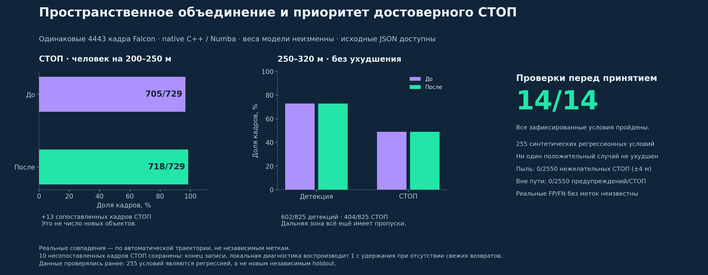

Сравнение `2e2cee7 →404f3c8`: одинаковый вход и веса; временная и покадровая ветви объединяются по пространственному соответствию, достоверный свежий СТОП получает приоритет над соседним неопределённым предупреждением. **705/729 →718/729** СТОП на 200–250 м; детекции и отрицательные контроли сохранены. Это парное сравнение двух изменений, а не изолированная абляция одного из них. [JSON и условия](docs/finals/spatial/quality/).

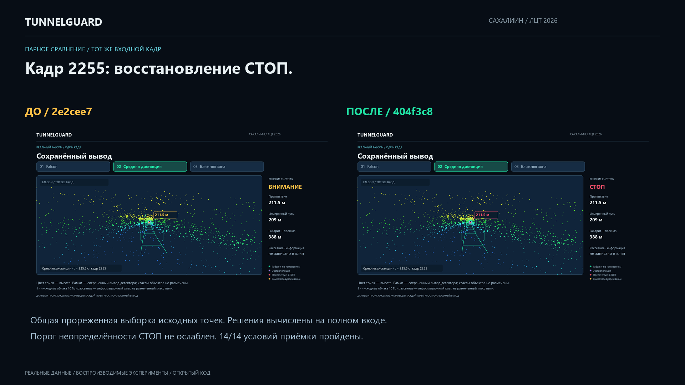

Визуальные круги рассеяния убраны: они ошибочно выглядели как локализованные препятствия. Информация о рассеянии сохранена; реальные жёлтые предупреждающие рамки не скрываются. Само удаление кругов не является снижением FP детектора.

## Предыдущие улучшения и изолированная абляция

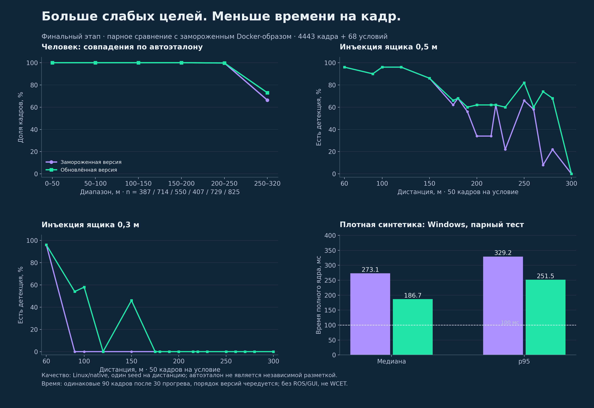

Прирост дальних совпадений сопровождается компромиссом: сопоставленных кадров СТОП **3177→3155/3612**. Парный Windows-тест: медиана **273,11→186,69 мс** (−31,6%), p95 **329,22→251,54 мс** (−23,6%); 90/90 кадров обеих версий >100 мс. [Исходные результаты и проверки](docs/finals/improvement/).

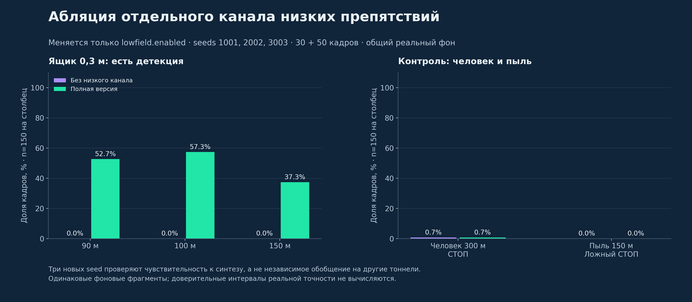

Меняется только низкий канал. Три seed: предупреждения ящика 0,3 м с нуля до **79/150 на 90 м**, **86/150 на 100 м**, **56/150 на 150 м**. СТОП на этих дистанциях остаётся нулевым. Контроль человека на 300 м в этом отдельном протоколе слабый; новый holdout ниже использует другие окна/seed и не подменяет этот результат.

Второй этап `f2af938 →96b7ac0` восстановил ещё **2** совпадения <250 м, но в полосе 200–250 м сопоставленных СТОП стало **718→705/729**. После пространственного исправления общий СТОП снова **3155/3612**; 13 кадров восстановлены относительно `2e2cee7`. История потери и последующего восстановления 13 кадров отдельно раскрыта в [отчёте](docs/IMPROVEMENTS_20261018_RU.md); последнее пространственное исправление восстановило эти 13 кадров, но не все потери относительно исходной версии.

## Обобщение: все запрошенные расстояния

**60, 90, 100, 120, 150, 175, 180, 190, 200, 215, 220, 230, 250, 260, 270, 280, 300 м.** Диагностическая лестница: человек, ящик 0,5 м, ящик 0,3 м, пыль — 68 условий, один seed на дистанцию.

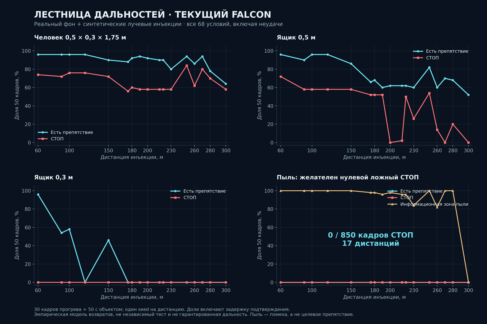

В панели сайта 96% означает 48/50 кадров с детекцией, 74% — 37/50 со СТОП. 126,6 — среднее число возвратов от инъекции, 0,2 с — задержка первого результата. 30 кадров прогрева +50 с объектом; кадры подтверждения включены в долю. Конкретные значения зависят от версии JSON. Это диагностические доли, не доверительный интервал точности.

Новый заранее зафиксированный тест: **255 условий, три seed, несколько реальных фоновых окон**. Положительные совпадения **4977/7650 →5096/7650**; все семь проверок пройдены, ни одно положительное условие не потеряло совпадений. Пыль и человек вне пути не добавили ложных СТОП. СТОП ящика снизился на один кадр. [Протокол, таблицы и ограничения](docs/finals/generalization/RESULTS_RU.md).

Пыль: информационный флаг в ±5 м от инъекции **2302/2550 (90,27%)**. Нулевые ложные СТОП/предупреждения проверены в ±4 м от инъекции; это не оценка всех неизвестных объектов реального фона.

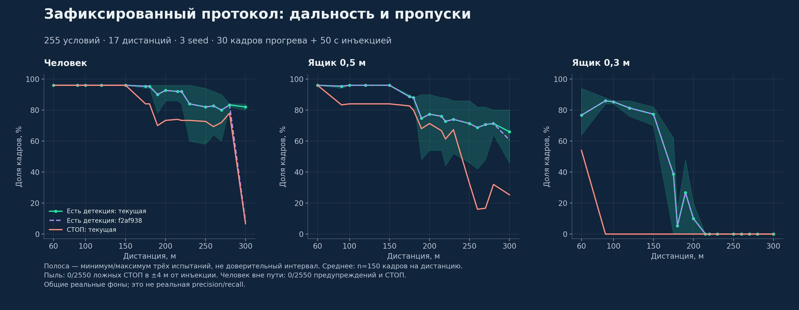

Движущийся поезд на аналитических кривых: прямая и ±800 м — 50/50 детекций и СТОП; ±500 м — 39/50 и 36/50 детекций, **есть пропуски**. В пустых сценах 0/250 препятствий. Сохранены также неудачные результаты старого статического теста. Это симуляция, не независимая реальная проверка движения.

## Базовая абляция финала и квалификация

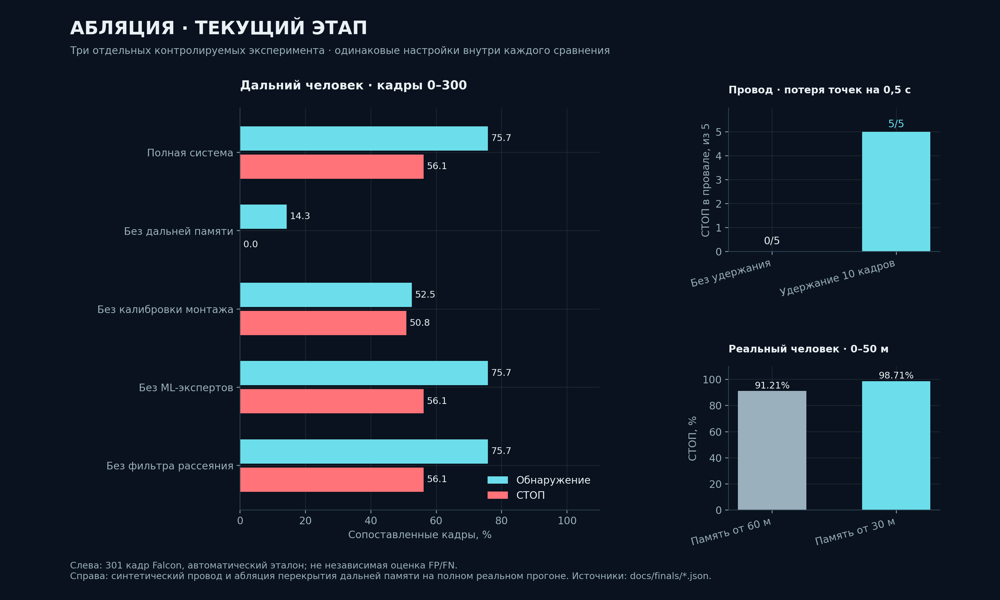

Эта картинка — базовый этап финала: первые 301 кадр Falcon, синтетический провод и перекрытие трактов. Последняя изолированная абляция низкого канала показана выше.

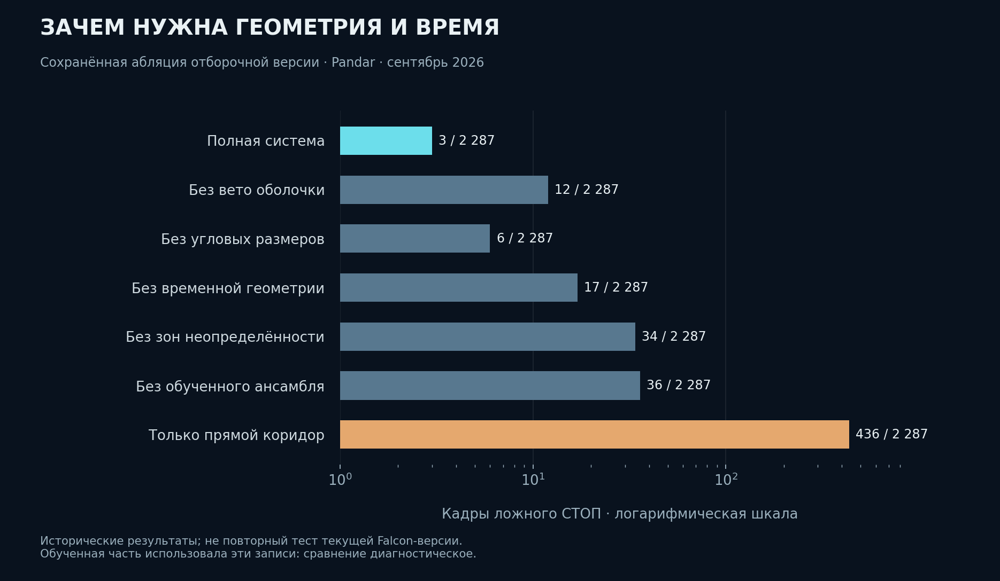

Исторические Pandar-данные использовались обученной частью; сравнение диагностическое и оптимистичное, не новый Falcon. [Диагностические изображения](docs/finals/diagnostics/) переименованы `image_1.png`…`image_5.png`; пиксели сохранены.

## Три записи, видео и пыль

Все три вкладки **Платформа / Стрелка / Тоннель** нового сайта — записи из `new_synth_data.zst`, а не три разных архива:

| № | Каталог бэга | Кадры | Интервал |
|---|---|---:|---:|
| 1 | `synthetic_platform_cloud_only` | 386 | 38,499987 с |
| 2 | `synthetic_switch_cloud_only` | 736 | 73,499907 с |
| 3 | `synthetic_tunnels_cloud_only` | 545 | 54,400106 с |

В каждом каталоге — metadata.yaml и одноимённый `_0.db3`. Всего **1667 кадров /166,4 с**. Вкладки Falcon отдельно показывают реальную запись `falcon_test.zst` (4443 кадра). `cloud_with_fake_obj.zst` — квалификационный архив; локальная копия **исправлена 19 октября** по общему источнику, SHA-256 и полный поток zstd проверены. Полный native-прогон: **1510 кадров**, p95 ядра **31,07 мс** (offline, не частота ROS).

Новый архив содержит облака, но доступной разметки классов/аэрозоля нет. Dust-zone — информационный признак рассеяния, а не доказательство класса и не ложный СТОП. Дальность/точность реального распознавания пыли и классов человека/ящика пока не измерены. Детектор обнаруживает препятствие в габарите, а не гарантирует семантический класс.

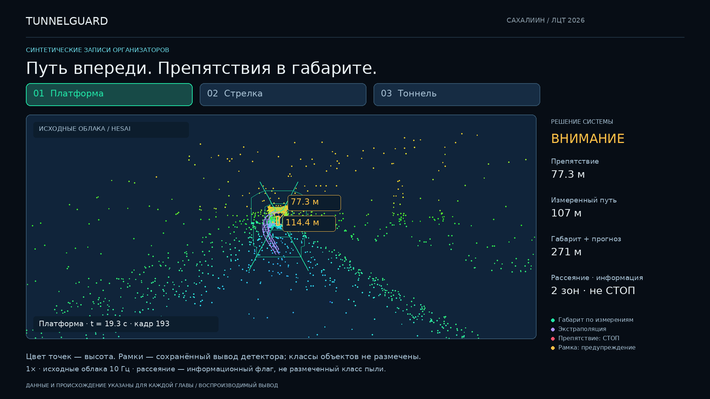

[Видео 1080p](https://ehimennathan.github.io/tunnelguard-lct2026/assets/tunnelguard_final.mp4) — **166,7 с**, платформа →стрелка →тоннель, русские подписи, вид вперёд, рамки и расстояния. Нормальная скорость 1×, все 1667 исходных облаков при 10 Гц; 20 fps видео не означает 20 Гц детектора. [Происхождение, главы и генерация](docs/CAB_VIDEO_RU.md). Локальная копия трёх записей: `C:\Users\ehime\Desktop\Moscow Competition\TunnelGuard_Три_записи_2026.mp4`.

## Полное видео: отдельные источники и цели испытаний

[Смотреть полный ролик на сайте](https://ehimennathan.github.io/tunnelguard-lct2026/#film) · [MP4 1080p](https://ehimennathan.github.io/tunnelguard-lct2026/assets/tunnelguard_all_datasets.mp4) · [происхождение и генерация](docs/COMPREHENSIVE_VIDEO_RU.md).

Реальный Falcon с первым совпадением на **256,56 м** → квалификация с искусственными объектами → все три новые синтетические записи организаторов → наши инъекции четырёх типов на всех **17** заданных дальностях. Каждый источник подписан. В инъекциях показаны последние 20 из 50 оценённых кадров; доли включают все 50 и время подтверждения. В клипах и файле скорость **1×**; 20 fps видео не означают 20 Гц детектора. Синтетика диагностирует дальность, устойчивость и нежелательный СТОП; она не подтверждает независимую реальную точность.

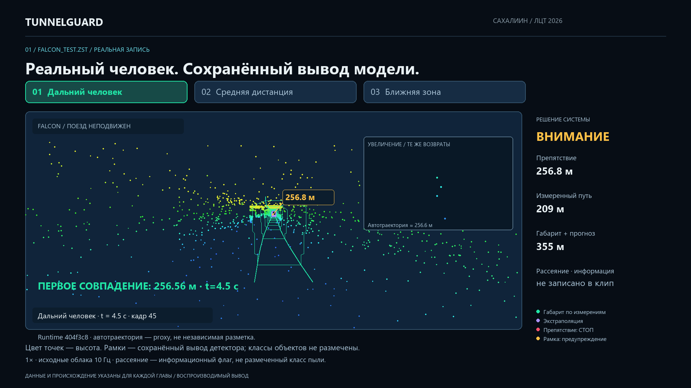

Основная локальная копия: `C:\Users\ehime\Desktop\Moscow Competition\TunnelGuard_Финал_2026.mp4`. [Хеши трёх исходных архивов](docs/data_sources.json); проверить их без распаковки: `python tools/verify_data_sources.py "D:\данные"`.

## Запуск на ПК или в облаке

**[Подробная инструкция с диагностикой](docs/RUN_ON_PC_RU.md)**. Нужны Docker с Linux containers +Compose v2, браузер и распакованные бэги. ROS, RViz и внешний X-сервер на хосте не нужны. Для ПК без места под Docker/WSL используйте [Codespaces](https://codespaces.new/EhimenNathan/tunnelguard-lct2026); вычисления и Docker выполняются в облаке. Условия/лимиты облака зависят от аккаунта.

```powershell
git clone --depth 1 https://github.com/EhimenNathan/tunnelguard-lct2026.git
Set-Location tunnelguard-lct2026
# Свой существующий каталог с распакованными бэгами:
.\run_windows.ps1 -Bags 'D:\данные\бэги'
```

Откройте [http://localhost:6080/vnc.html](http://localhost:6080/vnc.html), Connect, пароль `tunnelguard` или заданный TG_VNC_PASSWORD. В терминале контейнера:

```bash
tg bags
tg play /data/synthetic_platform_cloud_only 1.0
# Пробел — пауза; ↑/↓ — скорость; → — кадр; Ctrl+C — остановка player.
tg play /data/synthetic_switch_cloud_only 0.5 --start-paused
tg play /data/synthetic_tunnels_cloud_only 1.0
```

Менять контейнер не нужно; `tg play` выбирает топик и очищает состояние. Архив `.zst` не является готовым каталогом бэга. Runtime подключает `/data:ro`; распакуйте данные заранее либо одноразовым helper-контейнером с записью в каталог назначения, как в подробной инструкции. Не используйте `tg unpack` для записи в read-only runtime-том.

`compose.repro.yaml` и [reproduction_lock.json](docs/reproduction_lock.json) закрепляют конкретные проверенные образы; `compose.gui.yaml` использует обновляемый latest. Проверка закреплённой версии отдельно пройдена в CI 39108727258. Платформа linux/amd64; ARM-эмуляция отдельно не проверена.

## Полный облачный прогон новых записей

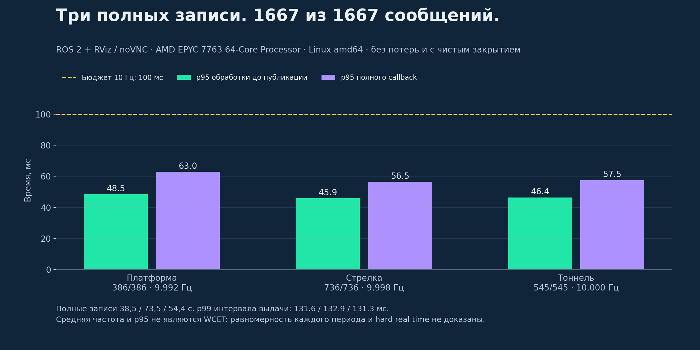

[Принятый CI](https://github.com/EhimenNathan/tunnelguard-lct2026/actions/runs/39107380132): 4 vCPU AMD EPYC 9V74, Linux amd64, ROS 2 +RViz/noVNC, полные 38,5 /73,5 /54,4 с. Первая попытка теряла сообщения и отклонена; очередь чтения player и shared memory исправлены. p99 интервала **127,60 /131,42 /128,25 мс**, один кадр обработки платформы >100 мс: это достижение средней частоты 10 Гц на указанном облачном CPU, не hard real time и не гарантия на любом ПК. [Все исходные логи и отчёты](docs/finals/dense_cloud/accepted/).

## Модель, файлы и продолжение работы

Модель: **физика + геометрия пути + два эксперта (пол/подвесные объекты), каждый ½ LightGBM +½ CatBoost +трекер/дальняя память**. Адаптивны оси, монтаж, угловая плотность, сплайн и временное состояние; онлайн-дообучения нет. При неопределённости дальний кандидат может дать только ВНИМАНИЕ, а не СТОП.

- Код: `src/tunnel_guard/tunnel_guard/core/`; C++: `src/tunnel_guard/native/geometry.cpp`; веса/параметры: `src/tunnel_guard/config/`.
- Оценка: `tools/finals_*`, `tools/curve_test.py`; CI: `.github/workflows/`.
- Доказательства: `docs/finals/`, `docs/finals/improvement/`, `docs/finals/generalization/`.
- Сайт/данные/видео: `web/`, `web/data/`, `web/assets/`.
- На исходном ПК: `C:\Users\ehime\Desktop\Moscow Competition\solution`; архивы и копия видео — в родительском каталоге. Большие исходные записи в Git не добавляются.
- [Полная передача задачи и исходные требования](docs/FINAL_HANDOFF_RU.md), [результаты и приоритеты улучшения](docs/IMPROVEMENTS_20261018_RU.md), [инструкция ПК](docs/RUN_ON_PC_RU.md).

Текущая субъективная оценка — **7/10 как конкурсный прототип**. Следующие приоритеты: проверить закреплённые опубликованные образы на другом ПК; получить реальные метки; разобрать каждый промах на крутых кривых; ускорить плотные кадры; проверить новые маршруты/сенсоры/пыль на замороженных независимых данных. Победа и нулевые ошибки на неизвестных данных не могут подтверждаться демонстрационным видео.
