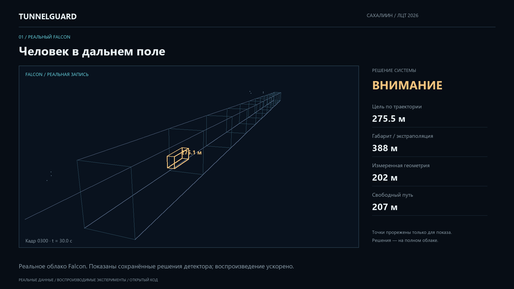

# TunnelGuard — финал ЛЦТ 2026

Обнаружение препятствий в габарите поезда метро по 3D-лидару. Гибрид геометрии, физических проверок, двух ансамблей LightGBM + CatBoost и временной памяти. ROS 2 Humble, RViz, C++/pybind11 ядро Gauss–Newton. Команда **СахалИИн**.

| Материал | Финал: текущая версия | Отбор: сохранённая версия |
|---|---|---|
| Сайт | **[Открыть новый сайт](https://ehimennathan.github.io/tunnelguard-lct2026/)** | **[Открыть сайт отборочного этапа](https://ehimennathan.github.io/tunnelguard-lct2026/qualification.html)** |
| Документация | [9 критериев с числами](docs/finals/METRICS_RU.md), [полная передача проекта](docs/FINAL_HANDOFF_RU.md) | [Предыдущий README](docs/QUALIFICATION_README_RU.md) |
| Видео | **[Демонстрация 1080p на русском](https://ehimennathan.github.io/tunnelguard-lct2026/assets/tunnelguard_final.mp4)** | Старые материалы — в истории и предыдущей документации |

Прототип для конкурсной оценки. Результаты не являются сертификацией безопасности и не гарантируют качество на неизвестных будущих записях.

## Требования экспертов и изменения

Эксперты просили ослабить фильтр, чтобы рано замеченный провод затем не терялся, стабилизировать дальний габарит и обеспечить 10 Гц. Также нужны Docker с GUI/RViz, пауза/скорость бэга, смена записей без рестарта и корректные оси другого лидара.

Восстановлена работа Claude, исправлены ROS startup, признаки плотности, наследование состояния и расхождение ROS/offline-настроек. Дальняя память перекрывается с ближним трактом от 30 м. Подтверждённый объект переживает краткую потерю точек; исправлена рамка удержанного провода. Добавлены native Falcon/±Z, C++ ядро, полный callback, облегчённая графика и CI с настоящими ROS-сообщениями и управлением player.



## Все девять критериев

Полный Falcon: **4 443 кадра**, статичный поезд. Эталон автоматически извлечён из той же записи, не независимая ручная разметка. Знаменатели и ограничения: [протокол](docs/finals/METRICS_RU.md).

| Критерий | Измеренный результат |
|---|---|
| 1. Первое обнаружение | **258,52 м**, кадр 66; первое СТОП **259,87 м**, кадр 82. Не гарантированная дальность |
| 2. Габарит | Медиана **387,64 м**, измеренная геометрия **202 м**; дальняя часть — экстраполяция |
| 3. Устойчивость | **0/4413** пропаданий geometry.ok после прогрева; p95 изменения оси **2,02 см на 150 м**, **47,24 см на 300 м** — вдали проблема остаётся |
| 4. Ложные срабатывания | **1/646 = 0,155%** сопоставленных СТОП на человеке вне пути; **10** кадров с несопоставленным СТОП. Полные FP/precision неизвестны |
| 5. Пропуски | На пути <250 м **2785/2787 = 99,93%** кадров с обнаружением; 250–320 м **517/825 = 62,67%**, то есть 308 без совпадения |
| 6. 10 Гц | Подтверждённый run `39021164621`: **301/301**, **10,00 Гц**, p95 обработки **53,35 мс**, полного callback **77,11 мс**. Не hard-real-time |
| 7. Фильтр | **68** синтетических условий; провод в провале 0,5 с **0/5 → 5/5** СТОП с удержанием; пыль **0/850** кадров СТОП |
| 8. Возможности | 2 ML-эксперта по 2 модели, C++ ядро, 3D, оси/монтаж/плотность, временная память и reset |
| 9. Удобство | Docker GUI/RViz в браузере; **9/9** проверок паузы/шага/скорости/нового бэга и топика при том же PID |

Полный Windows-прогон при параллельных тестах был медленнее 10 Гц; исходные времена сохранены. Облачный короткий тест его не заменяет. При намеренном завершении RViz в Xvfb/Mesa отмечен `shutdown_clean=false`; рабочий интервал прошёл без аварии. Последняя проверка GUI и публикация образа: [Docker CI](https://github.com/EhimenNathan/tunnelguard-lct2026/actions/workflows/docker.yml).

## Абляция текущего финального этапа


Слева одинаковые первые 301 кадр Falcon: полная система **75,75% обнаружений / 56,15% СТОП**, без дальней памяти **14,29% / 0%**, без калибровки монтажа **52,49% / 50,83%**. Без ML или scatter на этом отрезке результат тот же: дальний тракт может работать независимо от ML, а выбранный отрезок не проверяет аэрозоли. Это не доказательство ненужности компонентов на других сценах. [Исходные числа](docs/finals/ablation_current.json).

Справа отдельные опыты: удержание синтетического провода и полный реальный прогон, где СТОП на 0–50 м вырос **91,21% → 98,71%** при начале дальней памяти с 30 вместо 60 м. Разные знаменатели подписаны.

## Лестница всех запрошенных дальностей

**60, 90, 100, 120, 150, 175, 180, 190, 200, 215, 220, 230, 250, 260, 270, 280, 300 м.** Человек, ящики 0,5 и 0,3 м, пыль: 17×4=68 условий. Лучи, отражаемость, фаза сканирования, окклюзия и объёмный аэрозоль добавляются в настоящий фон Falcon. Новый детектор на условие, 30 кадров прогрева + 50 с объектом, один seed. Это диагностический стресс-тест, не доверительный интервал обобщения.


Человек: **60 м 96%/74%**, **250 м 94%/84%**, **300 м 64%/58%** (обнаружение/СТОП). Ящик 0,5 м: **60 м 96%/76%**, **200 м 34%/0%**, **300 м 8%/2%**. Ящик 0,3 м: **60 м 94%/0%**, с 90 м в этой лестнице обнаружений нет. Низкие малые ящики — выявленная слабость. Полная [таблица](docs/finals/METRICS_RU.md), [JSON](docs/finals/ladder.json).

**Карточка «Человек · 60 м»:** 96%=48/50 кадров с препятствием, 74%=37/50 со СТОП; 126,6 — среднее число синтетических возвратов от человека за кадр; 0,2 с — первая детекция после инъекции. СТОП требует дополнительных свидетельств и подтверждения, стартовая задержка включена. Нельзя называть это «96% точности модели вообще».

Пыль — помеха, а не твёрдое препятствие: желательны информационная зона аэрозоля и отсутствие ложного СТОП. В лестнице **0/850** кадров дали СТОП около пыли. Это не recall распознавания пыли и не доказательство обнаружения скрытого за ней человека. Симулятор эмпирический, не POD даташита. Новые записи организаторов анализируются отдельно; название файла и автоматический dust-флаг не заменяют разметку.

## Историческая абляция отборочного этапа


Прежняя работа на 2 287 отрицательных Pandar-кадрах, помогавшая пройти в финал. Обучение использовало эти записи; сравнение диагностическое и оптимистичное. Это **не новый Falcon-тест**. [Исходные JSON](tools/results), [пять сохранённых изображений Claude](docs/finals/diagnostics).

## Запуск на ПК: GUI без внешнего X-сервера

**[Подробный RUN_ON_PC_RU.md](docs/RUN_ON_PC_RU.md)**: проверка среды, Windows/Linux/macOS, готовый образ, сборка, тома, RViz, player, offline, оси и диагностика.

При уже установленном Docker с Compose, в корне клонированного репозитория:

```powershell
# Замените путь своим существующим каталогом распакованных бэгов
$env:TG_BAGS_DIR='D:\данные\бэги'
docker compose -f compose.gui.yaml pull
docker compose -f compose.gui.yaml up -d
```

Откройте **[http://localhost:6080/vnc.html](http://localhost:6080/vnc.html)** → Connect → пароль `tunnelguard`. В терминале рабочего стола:

```bash
tg bags
tg play /data/ИМЯ_БЭГА 1.0
# Пробел — пауза; ↑/↓ — скорость; → — кадр; Ctrl+C — остановить player
tg play /data/ДРУГОЙ_БЭГ 0.5
```

Для заполненного Windows-диска: **[Codespaces без локального Docker/WSL](https://github.com/codespaces/new?hide_repo_select=true&repo=EhimenNathan%2Ftunnelguard-lct2026)** → PORTS → 6080 → рабочий стол. Нужна облачная квота. Короткий Falcon-бэг создаётся потоково в облаке, полный архив на ПК повторно не скачивается.

## Модель, адаптивность и воспроизводимость

`PointCloud2 → оси/монтаж → рельсы/геометрия/σ → габарит → физика + ½·LightGBM + ½·CatBoost → треки + дальняя память → предупреждение/СТОП`.

Два эксперта — для объектов у пола и подвешенных. Адаптируются оси, монтаж, нормировка плотности, геометрия и временное состояние. Веса ML онлайн не переобучаются, clutter-adapt выключен по умолчанию. Выравнивание приближённое, без полного SLAM/IMU deskew. C++ переносит накопление нормальных уравнений Gauss–Newton; паритет с Numba проверен, ускорение относительно прогретой Numba не заявляется. GPU нет.

В облаке 23 теста с обязательным native; локально 22 + 1 пропуск без расширения. Проверяются также рельсоподобные артефакты, reset, оси и согласованность YAML. [Кривые](docs/finals/curves.json) включают неудачи: стационарная аналитика не доказывает качество на реальном движущемся поезде в повороте.

**[FINAL_HANDOFF_RU.md](docs/FINAL_HANDOFF_RU.md)** содержит постановку, сообщения экспертов, PDF, все пути, команды, параметры, эксперименты, исправления и оставшиеся задачи. Всё продолжается в том же репозитории. Крупные архивы в Git не включены.

Проверяемые результаты: [сводка](docs/finals/summary.json), [решения по кадрам](docs/finals/rows.json), [ось пути](docs/finals/geometry.json), [провод](docs/finals/wire.json), [управление](docs/finals/controls_check.json), [ROS](docs/finals/live_check.json), [C++](docs/finals/native_benchmark.json). Сайт воспроизводит сохранённый вывод, не запускает детектор в браузере. Видео — ускоренная демонстрация с русскими подписями.


## Дополнительные данные организаторов

`new_synth_data.zst` полностью прочитан без распаковки: **1 667/1 667 кадров**, 3 бэга (platform 386, switch 736, tunnels 545), после 30 кадров прогрева каждого **1577/1577** кадров с geometry.ok. Есть **440** кадров СТОП, **546** ВНИМАНИЕ и **596** с информационной зоной пыли. Это количества выходов, не качество по классам: независимых меток в архиве нет, поэтому FP/FN и дальность обнаружения человека/ящика в нём неизвестны. [Полный протокол](docs/finals/new_synth/summary.json). Все три записи доступны в 3D-панели нового сайта.

Отдельная оценка синтетической пыли: зона отмечена в 100% кадров на 60–150 м, 96–98% на 175–220 м, 76% на 230 м, 88% на 250 м, 82% на 260 м, 100% на 270–280 м и 0% на 300 м. На всех расстояниях 0/850 СТОП около пыли. Немонотонность связана с фазой/фоном и одним seed, не гарантирует работу на любой дистанции. [dust_zones.json](docs/finals/dust_zones.json).

В предоставленном `cloud_with_fake_obj.zst` независимая проверка zstd обнаружила повреждение потока после около 6,28 ГБ распакованных байтов. Частичный replay сохраняется с `complete=false`; полный прогон требует исправной копии архива. Это не ошибка детектора и не успешная проверка всей записи.

Последний подтверждённый GUI-run [39021164621](https://github.com/EhimenNathan/tunnelguard-lct2026/actions/runs/39021164621) проверяет настоящий noVNC, ROS и RViz: 301/301, 10,00 Гц, p95 обработки 53,35 мс и полного callback 77,11 мс; 9/9 управления. [Отдельные артефакты GUI](docs/finals/gui).
