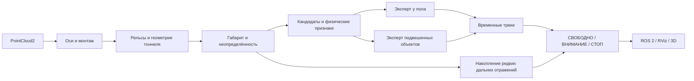

# TunnelGuard: финал ЛЦТ 2026 — полная передача проекта

Обновлено 17 октября 2026 года. Репозиторий: [EhimenNathan/tunnelguard-lct2026](https://github.com/EhimenNathan/tunnelguard-lct2026). Работа продолжается в том же репозитории. Отборочная версия сохранена в истории Git, в [старом README](QUALIFICATION_README_RU.md) и на странице `web/qualification.html`.

Это документ для продолжения работы на другом компьютере: постановка задачи, изменения, данные, команды, результаты и известные ограничения собраны вместе. Числа финальных измерений вынесены в [протокол](finals/METRICS_RU.md) и соответствующие JSON, чтобы не смешивать старые и новые прогоны.

## 1. Что потребовали организаторы

Команда прошла в финал. Организаторы сообщили о расширении набора: дополнительная синтетическая запись с похожими облаками, человеком и пылью/аэрозолем; реальная запись другого лидара с человеком примерно в 300 м от неподвижного поезда. Результат финала будет зависеть от обнаружения препятствий в этих записях. В рабочем каталоге обнаружена запись `falcon_test.zst`; будущие дополнительные записи нельзя считать проверенными, пока они не получены и не проиграны.

Ключевое замечание экспертов, в переводе:

> Немного ослабить фильтр: провод виден достаточно рано, что хорошо, но затем теряется, что плохо. Стабилизировать общую картину на большой дальности и оптимизировать работу в реальном времени.

Все девять критериев оценки:

1. Дальность первого обнаружения препятствия.
2. Дальность построения габарита.
3. Устойчивость габарита: без мерцания, исчезновения и ухода с пути.
4. Отсутствие ложных срабатываний.
5. Отсутствие пропусков.
6. Работа с частотой 10 Гц.
7. Качество фильтра.
8. Дополнительные возможности.
9. Удобство использования.

Отдельно нужны Docker с графическим интерфейсом, RViz внутри контейнера, доступная из консоли пауза/замедление `ros2 bag play` и быстрое переключение записей без перезапуска контейнера. Требуется учесть различную ориентацию осей другого лидара.

Дополнительные требования команды: не устанавливать Docker Desktop/WSL на заполненный Windows-диск; проверять контейнер в облаке; объяснить архитектуру модели; проверить криволинейный путь, провести инъекции человека, ящиков и пыли на 17 расстояниях; перенести вычислительное ядро на C++ или GPU; проверить непрерывность рельсов; подготовить русские сайт, видео, иллюстрации и подробную документацию; сохранить всё в исходном репозитории.

## 2. Что является моделью

TunnelGuard — гибрид геометрии, физических проверок, обученного скоринга кандидатов и временной памяти. Это не нейросеть распознавания классов «человек / пыль»: выход сообщает о занятости габарита, опасности и расстоянии.



Каждый из двух экспертов содержит LightGBM и CatBoost. Их выходы объединяются с весами ½ и ½ в пространстве логитов, затем применяется sigmoid и порог модели. Маршрутизация к подвесному эксперту зависит от высоты основания кандидата над рельсами (`route_hang_h`, по умолчанию 0,5 м). Порог, сглаживание и деревья хранятся в `src/tunnel_guard/config/obstacle_scorer*.json`. Инференс выполняет NumPy-код `core/scorer.py`, установка обучающих библиотек для запуска не нужна. Геометрия и дальняя память могут выдавать решения независимо от прохождения кандидатом обученного скорера; поэтому это не простой каскад «всё обязательно проходит ML».

Основной тракт:

- Поля `PointCloud2` читаются по именам, смещениям, типам и порядку байтов.
- `cloud.py` приводит облако к X вперёд, Y влево, Z вверх. `MountCalibrator` оценивает монтажный наклон/крен. Плотность отражений используется для нормировки признаков нового сенсора.
- `geometry.py` ищет парные рельсовые гребни с проверкой колеи и продолжения вдоль пути. Динамическое программирование предпочитает непрерывный путь одиночным похожим артефактам. Оцениваются ось, рельсовая плоскость, кривизна, шаблон сечения и неопределённость σ.
- `gauge.py` классифицирует точки относительно профиля поезда и неопределённости. Измеренная геометрия и продолжение модели вдаль имеют разную достоверность.
- `cluster.py`, `features.py` и физические проверки используют размеры в угловых шагах, опору, оболочку тоннеля, форму, объёмное рассеяние и временные свойства.
- `tracker.py` связывает кандидатов, оценивает скорость сближения, подтверждает треки. Сглаживание оценок и ограниченное удержание СТОП переживают краткий провал отражений.
- `farfield.py` хранит свидетельства в метровых ячейках на окне 15 кадров. По умолчанию нужны 6 кадров с отражениями для обнаружения, 9 для СТОП и минимум 8 точек в окне. Используется соседство ±1 ячейка, проверяются боковое положение, высота, опора и σ. Пылевые отражения исключаются из накопления.

Дальняя память сдвигается на оценённый путь поезда; проверка ego-motion отличает статичное препятствие от артефакта, «едущего» вместе с сенсором. Это приближённое временное выравнивание по лидарной оценке движения и состоянию пути. Здесь нет полноценного SLAM, IMU deskew каждого луча или обученной межкадровой регистрации. Запись Falcon сделана со статичного поезда и не подтверждает качество компенсации на быстром движении в кривом тоннеле.

### Адаптивность

Поддерживаются автоопределение ведущей оси, калибровка монтажа, адаптация нормировки к плотности сенсора, оценка геометрии/σ по кадрам, временные треки и компенсация движения. Веса ML при запуске не переобучаются. Модуль `adapt.py` для онлайн-калибровки помех присутствует, но `adapt.enabled=False` по умолчанию. Нельзя описывать прототип как самостоятельно переобучающуюся универсальную систему.

## 3. Что изменено после восстановления работы Claude

Восстановлены локальные изменения, журналы, автоматическая траектория, прежние эксперименты и пять диагностических изображений. История изменений остаётся в Git.

| Изменение | Причина и практический эффект |
|---|---|
| Исправлена неопределённая переменная топика в ROS-узле | Старый облачный job мог быть зелёным при аварии узла. Теперь запуск проверяется по реальным сообщениям |
| Готовность launch проверяется по префиксу ROS-логгера | Строка исходного кода внутри traceback больше не считается сообщением о готовности |
| Нормировка плотности хранится в экземпляре детектора | Два детектора и последовательные записи не загрязняют друг другу признаки |
| Исправлены доля точек в габарите и нормированный счётчик | Доля считается по исходному числу точек; модель получает согласованные признаки |
| Добавлены нативные Falcon-оси и ±Z | Новый лидар может смотреть вперёд вдоль собственной Z; нельзя всегда предполагать ROS X |
| Полный reset очищает дополнительные треки и историю скоринга | Смена бэга не наследует подтверждение старого объекта |
| ROS YAML синхронизирован с offline-конфигурацией | Ранее онлайн работали старые max_range/report_cap, несмотря на новые offline-результаты |
| Дальняя память начинается с 30 вместо 60 м | Устранён разрыв временного подтверждения в перекрытии ближнего и дальнего трактов; сравнительный результат — в протоколе |
| C++/pybind11 ядро Gauss–Newton | Компилируется при сборке Docker, есть численный паритет с Numba |
| Надёжный QoS при воспроизведении бэга | Крупные облака не должны теряться из-за несовпадения QoS; reset пересоздаёт подписку |
| Полный callback измеряется отдельным топиком | Время обработки ядра больше не выдаётся за полное время с сериализацией и публикацией |
| Графика ограничена 5 Гц, шаг габарита 8 м | Решения остаются на каждом кадре; меньше Python-объектов при сериализации треугольников RViz |
| Рамка удержанного препятствия использует сохранённый размер/центр | При пустом текущем наборе точек рамка больше не прыгает в начало координат |
| Независимая проверка управления проигрывателем | Пауза, шаг, скорость и переход на другой топик проверяются в настоящем ROS-контейнере |
| Русские сайт, видео и пакет воспроизводимости | Реальные кадры отделены от синтетических инъекций; опубликованы источники чисел и ограничения |

Значимые коммиты: `eb0ffaf` — ROS/признаки; `1f6a75f` — C++; `e3d7192` — оси/reset; `523fe9b` — конфигурация; `4a99899` — установленный native в CI; `70f75bb` — перекрытие от 30 м; `8175a13` — управление; `3a81235` — полный callback; `2d5301b` — стоимость RViz и рамка провода. Точный публикуемый HEAD смотрите через `git rev-parse HEAD`; результаты имеют собственное происхождение, а не автоматически приписываются последнему коммиту документации.

## 4. Провод, устойчивость и фильтр

Нельзя просто снять все фильтры: раннее обнаружение провода тогда может сопровождаться множеством ложных СТОП от оболочки, крепежа и рельсов. Реализованы угловые критерии размера, два ML-эксперта, временное подтверждение и ограниченная память подтверждённого объекта. `hold_frames=10` удерживает СТОП при коротком пропадании отражений. Сброс/перескок времени очищает память.

Контролируемый тест `tools/finals_regressions.py`: 80 кадров синтетического тоннеля, 30 кадров прогрева, тонкий провод на 60 м, потеря его точек на 5 кадров, затем повторное появление. При `hold_frames=0` в провале 0/5 обнаружений и 0/5 СТОП; при 10 — 5/5 и 5/5. Это доказательство механизма удержания, а не повторная оценка исходного организаторского бэга с проводом. Пять кадров при 10 Гц — 0,5 с. Удержание добавляет инерцию при настоящем исчезновении объекта; его нужно оценивать и на отрицательных интервалах.

Габарит в RViz имеет отдельное EMA-сглаживание (`display_smoothing=0.6`). Оно влияет на рисунок, а решения используют текущую геометрию. Нельзя считать гладкую визуализацию доказательством точности. В протоколе приведён p95 сырого покадрового изменения оси на разных расстояниях; на 300 м оно существенно больше, чем на 150 м.

Нулевая доля геометрических dropout означает, что флаг `geometry.ok` не пропал после прогрева. Она не означает нулевое мерцание всех рамок, постоянную точность или отсутствие дрейфа. Увеличенная длина габарита включает экстраполяцию; медиана измеренной геометрии публикуется отдельно. Поле `_reach`, сохраняющее достигнутую дальность, делает длину габарита инерционной, поэтому малый jitter длины сам по себе не характеризует точность.

## 5. Новый LiDAR: спецификация и оси

Использованы локальные документы:

- `Innovusion_Falcon-Prime-1_Datasheet_EN_Public_20230215.pdf` — 4 страницы.
- `Seyond_Falcon_Prime_LiDAR_System_V1_0_2_English_public_20221214.pdf` — 56 страниц, система осей в разделе 1.4.

В нативной системе Falcon X направлена вверх, Y вправо, Z вперёд. Преобразование в используемую систему: `X_forward = Z_native`, `Y_left = -Y_native`, `Z_up = X_native`. В предоставленном бэге координаты уже ориентированы как ROS X вперёд / Z вверх. Повторное применение нативного преобразования испортит геометрию. Предпочтительна проверка облака и явный режим для неизвестного драйвера; `auto` остаётся эвристикой, а не гарантией.

Режимы `forward_axis`: `auto`, `x`, `-x`, `y`, `-y`, `z`, `-z`, `falcon`. Для нативного Falcon можно использовать `falcon` или соответствующий +Z режим. В тестах проверяются и нативное, и уже преобразованное облако.

Даташит указывает максимальную дальность до 500 м и 250 м по мишени с отражаемостью 10% при 10 Гц и POD >90%. Это характеристики сенсора в условиях спецификации, не гарантированная дальность обнаружения человека нашим алгоритмом. Угловая сетка зависит от режима/области интереса. Эмпирический симулятор отражений не воспроизводит весь даташит и не должен так описываться.

## 6. Данные, эталон и методика полного прогона

Локальный каталог: `C:\Users\ehime\Desktop\Moscow Competition`.

| Файл/каталог | Назначение |
|---|---|
| `solution` | Исходный Git checkout |
| `falcon_test.zst` | Уже скачанный архив организаторов, 6 758 209 772 байта |
| `falcon_cache.bin` | Существовавший декодированный кеш, 1 718 433 882 байта |
| `falcon_cache.bin.idx.npy` | Индекс кеша для потокового чтения кадров |
| `C:\Users\ehime\Downloads\Telegram Desktop\*.pdf` | Указанные выше спецификации |
| `C:\Users\ehime\Documents\Codex\2026-10-17\i\work` | Промежуточные прогоны, загруженные результаты CI, извлечённый текст PDF |
| `C:\Users\ehime\Documents\Codex\2026-10-17\i\outputs` | Готовый пакет для пользователя |

Запись Falcon: 4 443 кадра, около 444 с, неподвижный поезд и движущийся человек. Полный прогон выполняется без нового скачивания по существующему кешу. Каждая метрика имеет знаменатель; неизвестная траектория не объявляется отрицательным классом.

`docs/finals/reference_automatic.json` — восстановленная `truth2.json` Claude. Это автоматически извлечённая траектория из той же записи, а не независимая ручная разметка. `fill_gaps` интерполирует часть пропусков. Есть 4 411 кадров с доступной/интерполированной траекторией, 624 интерполированных и 32 неизвестных. Полная ручная разметка препятствий, свободного пути, крепежа, пыли и рельсов отсутствует.

В `finals_bundle.py` объект сопоставляется при разнице продольной дистанции <6 м и бокового положения <1 м. Положительные кадры на пути: `|truth_y - 0.35| < 1.3 м`; вне пути: ≥1.6 м; переходная полоса исключена из этих двух групп. Продольная координата здесь — параметр X вдоль направленного облака, а не интеграл длины дуги на крутом повороте. Первое обнаружение и первое СТОП — первые подходящие кадры; человек может в начале удаляться, поэтому дистанция первого СТОП может быть больше дистанции первого обнаружения.

Сохраняются покадровые решения, совпадения, координаты оси на 25/50/100/150/200/250/300 м, измеренная дальность, габарит, время обработки и прореженные клипы для визуализации. Детектор обрабатывает полное облако, прореживание делается после решения только для сайта/видео.

FP и FN всех типов по этому эталону неизвестны. «Несопоставленный СТОП» может быть другим настоящим объектом, ошибкой траектории, задержкой трека или ложным срабатыванием. Доля СТОП на сопоставленном человеке вне пути — полезная диагностическая величина, но не полная false-positive rate системы.

## 7. Лестница синтетических инъекций

Расстояния: **60, 90, 100, 120, 150, 175, 180, 190, 200, 215, 220, 230, 250, 260, 270, 280, 300 м**.

В `falcon_ladder.py` проверяются четыре воздействия: человек 0,5×0,3×1,75 м (ρ=0,10), ящик 0,5 м (ρ=0,20), ящик 0,3 м (ρ=0,20), пылевое облако 2,4×3×2,5 м (σ=0,6). Итого 68 условий. Для каждого создаётся новый детектор, 30 кадров прогрева и 50 кадров с объектом; seed равен дистанции. Участок выбирается так, чтобы реальный человек был не ближе 25 м к синтетической цели.

`falcon_inject.py` создаёт угловые лучи, случайную фазу сканирования, поверхности и окклюзию настоящих точек за объектом. Вероятность твёрдого возврата — эмпирическая logistic с R50=275 м при 10% отражаемости; при 250 м она около 76%, что НЕ равно POD >90% из даташита. Настройка сопоставлялась с числом возвратов реального человека примерно на 260 м. Это приближённый стресс-тест, не валидированный цифровой двойник сенсора. Пыль моделируется объёмным затуханием и случайной глубиной возврата.

Метрика `detected` — доля 50 кадров с выходом в окрестности ±4 м от инъекции; `stop` — доля со СТОП там же. Подтверждение входит в знаменатель. Это не независимые 50 испытаний, кадры сильно коррелированы. Совпадение по дистанции может переоценивать результат, если в той же области есть другой объект; автоматический выбор участка снижает, но не исключает этот риск. Для пыли низкие detected/stop желательны. Нулевой СТОП от пыли не доказывает сохранение чувствительности к скрытому за ней человеку: отдельный смешанный клип демонстрирует только один выбранный сценарий.

На сайте панель **не запускает детектор**: она показывает сохранённые результаты этой лестницы. Фрагмент «СИНТЕТИКА» отдельно показывает человека на 200 м и пыль на 120 м в реальном фоне; маркировка видна в интерфейсе и видео. Полная таблица с ящиками, включая неудачи, находится в `finals/METRICS_RU.md`.

### Криволинейный путь

`curve_test.py` использует аналитический тоннель с известной осью `y=x²/(2R)`: прямая и R=800/500/300 м, плотное и случайно прореженное облако. Проверяются медианная ошибка оси на 25–150 м и ящик в 40/80/120/150 м. Последняя версия использует установленный в проекте основной ML-эксперт и сравнивает продольную X-координату, а не ошибочно вычисленную длину дуги.

Это стационарная синтетика: независимое прореживание не воспроизводит Falcon-сканирование, генератор не моделирует полную окклюзию поверхностей, на кривых нет движущегося поезда и IMU. Сырой результат включает провалы обнаружения и не должен преподноситься как доказательство универсальной работы в поворотах. Полные результаты сохранены в `finals/curves.json`; требуется реальная кривая запись с движением и независимым эталоном. Ящик на 120 м оказался особенно проблемным в этой диагностике: его нельзя скрывать выбором только удачных дистанций.

## 8. C++ и производительность

`src/tunnel_guard/native/geometry.cpp` переносит цикл накопления нормальных уравнений Gauss–Newton. Это один важный участок геометрии, не полный перенос всей системы на C++. Используется pybind11, `-O3`, double, освобождение GIL и проверки форм/индексов. `TG_NATIVE=1` включает сборку в `setup.py`; Docker задаёт его автоматически. NumPy/Numba fallback остаётся для Windows и сред без компилятора. GPU не добавлен: для небольших последовательных геометрических задач его преимущество не доказано, а передача данных может съесть выигрыш.

Тест паритета сравнивает все выходные массивы C++ и Numba с atol/rtol 1e-10; в облачном прогоне максимальное абсолютное расхождение 0. Микробенчмарк использует 12 000 точек, 500 узлов и 101 повтор. Точное время каждого варианта находится в `finals/native_benchmark.json`. C++ здесь не быстрее уже прогретой Numba; его преимущества — скомпилированное исполнение и отсутствие JIT именно этого ядра. Нельзя обещать ускорение всей системы по одному микробенчмарку.

Различаем три времени:

1. `FrameResult.timings['total']`: вычислительное ядро.
2. `ObstacleStatus.processing_time_ms`: чтение/подготовка сообщения и детектор до публикации.
3. `/tunnel_guard/callback_ms`: весь callback, включая формирование и публикацию вывода/графики до отправки самой временной метрики.

Частота измеряется по приходу настоящих ROS-решений с отброшенным прогревом. Времена полного локального прогона получены на Windows одновременно с другими экспериментами: это стрессовая загрузка, не сравнение процессоров. Их хвосты сохраняются в JSON и не подменяются облачным результатом. Облако проверяет 301 кадр, а не всю 4 443-кадровую запись. Ни 10 Гц в одном прогоне, ни p95<100 мс не означают hard-real-time: для этого нужны WCET, пределы очередей, планировщик и доказательство сроков на целевом железе.

## 9. Облачная проверка контейнера

Workflow `.github/workflows/docker.yml`:

1. Собирает ROS 2 Humble desktop образ.
2. Импортирует установленный пакет, проверяет `HAVE_NATIVE`, затем запускает pytest. Это важно: подмена установленного пакета исходным каталогом раньше незаметно пропускала C++-тест.
3. Потоково читает начало архивной записи с Яндекс.Диска и создаёт небольшой стандартный sqlite3 ROS-бэг на облачном раннере.
4. Проверяет паритет и микровремя C++/Numba.
5. Запускает offline-оценку с `--network none`.
6. Запускает настоящий ROS-узел, RViz и Xvfb, получает сообщения, делает снимок, измеряет частоту, обработку и полный callback; проверяет СТОП и порядок timestamps.
7. Проверяет управление проигрывателем и переход на второй бэг с другим топиком при том же PID детектора.
8. Сохраняет JSON, CSV, журналы и снимок; публикует образ в GHCR только после успешных шагов.

Запуск `39002960953` доказал 301/301 сообщений и 9,88 Гц после исправления старого ложнозелёного теста. Более поздний `39003792478` подтвердил 301/301, 10,00 Гц и все 9 проверок управления, но p95 полного callback около 100,5 мс. Следующий коммит уменьшает стоимость графики; актуальный подтверждённый результат указан в протоколе. Исторические хорошие числа не приписываются новой версии без повторного теста.

В headless Xvfb/Mesa замечен segfault RViz при намеренном завершении launch, после записи результатов. Он отражён полем `shutdown_clean=false`. Проверка `no_crash` относится к рабочему интервалу до teardown. Это известная проблема завершения графики в данном окружении; её нельзя называть аварией детектора во время обработки или скрывать как полностью чистый запуск.

## 10. Запуск в браузере без Docker Desktop и WSL

Откройте [новый Codespace](https://github.com/codespaces/new?hide_repo_select=true&repo=EhimenNathan%2Ftunnelguard-lct2026), выберите ветку main, дождитесь сборки `.devcontainer`. Требуются облачная квота GitHub и доступ к исходным данным. Эта инструкция и образ проверяются через CI; создание интерактивного платного Codespace автоматически не выполнялось.

Конфигурация устанавливает `desktop-lite`, пробрасывает порт 6080, задаёт software GL, 4 CPU/8 ГБ RAM как запрос к хосту. Пароль демонстрационного noVNC: `tunnelguard`. Оставляйте порт приватным. `.devcontainer/setup.sh` создаёт короткий бэг Falcon в `/workspaces/bags/falcon_test` потоково и добавляет ROS setup в терминал.

Во вкладке PORTS откройте 6080, затем терминал рабочего стола:

```bash
tg start
tg bags
tg play falcon_test 1.0
```

В терминале `ros2 bag play`: пробел — пауза/продолжение, ↑/↓ — скорость, → — следующий кадр при паузе, Ctrl+C — остановка проигрывателя. Если терминал открыт через интерфейс, не передающий клавиши, доступны стандартные ROS-сервисы `/rosbag2_player/pause`, `/resume`, `/play_next`, `/set_rate`, `/get_rate`.

```bash
# После Ctrl+C: тот же контейнер и детектор, другая запись
tg play другой_бэг 0.5

# Старт на паузе, последующий ручной шаг
tg play falcon_test 1.0 --start-paused

tg status
tg reset
tg stop
```

`tg play` определяет PointCloud2-топик из metadata, включает reliable QoS, сбрасывает состояние и запускает штатный player. Новый топик обнаруживается узлом автоматически. Смена темы, пауза, скорости 0,5 и 0,25 и неизменный PID проверены программно в контейнере.

### Можно ли работать онлайн без скачивания архива?

Да: `tools/falcon_stream.py` читает HTTPS → zstd → tar → SQLite-страницы → PointCloud2, не сохраняя целый архив и не распаковывая его на Windows. Сетевой трафик всё равно передаётся; «без скачивания» здесь означает отсутствие полной локальной копии. Для произвольного позднего участка последовательное сжатие требует прочитать предыдущую часть потока. Для многократных локальных экспериментов использован существующий кеш, новый архив на ПК не загружался.

```bash
python3 tools/falcon_stream.py 30
# В облаке: короткий воспроизводимый ROS-бэг из кадров 0..300 включительно
python3 tools/falcon_export_bag.py /workspaces/bags/falcon_test 0 300
```

Для настоящего `ros2 bag play` небольшой материализованный бэг сохраняется на облачном диске; это не бесконечный прямой поток в RViz. Исходный большой архив не включён в Git/образ. Полный бэг можно распаковать в облаке через `tg unpack`, если хватает облачного диска.

### На машине с уже установленным Docker

```bash
docker pull ghcr.io/ehimennathan/tunnel_guard:latest
docker run --rm -it --network host -v /путь/к/бэгам:/data \
  ghcr.io/ehimennathan/tunnel_guard:latest tg play falcon_test 1.0
```

Этот вариант — без GUI. Для графики используйте Codespaces выше либо имеющийся Linux/X11 с `DISPLAY` и сокетом X11. Пользователю Windows не предлагается устанавливать Docker/WSL или тратить оставшийся диск.

## 11. Повторение экспериментов

Для offline-инструментов достаточно Python с NumPy, SciPy, Numba, zstandard; для видео нужны Pillow, imageio, imageio-ffmpeg, для рисунков matplotlib. Версии облачной среды и происхождение данных сохраняются в JSON. ROS и C++ лучше повторять в Docker, где окружение фиксируется Dockerfile.

```powershell
Set-Location 'C:\Users\ehime\Desktop\Moscow Competition\solution'
$env:PYTHONUTF8='1'
$cache='C:\Users\ehime\Desktop\Moscow Competition\falcon_cache.bin'
$truth='docs/finals/reference_automatic.json'
python tools/finals_bundle.py $cache $truth local_results/falcon
python tools/falcon_ladder.py $cache $truth local_results/ladder.json
python tools/finals_regressions.py local_results/wire.json
python tools/curve_test.py local_results/curves.json
python tools/falcon_synthetic_clip.py $cache local_results/synthetic_clip.json
python tools/finals_figures.py
python tools/finals_video.py web local_results/tunnelguard_final.mp4
python -m pytest -q src/tunnel_guard/test
```

Создайте `local_results` перед запуском инструментов, принимающих путь к файлу. В Windows native-тест может быть пропущен, если расширение не собрано: это не успешная проверка C++. В контейнере CI требует native и не допускает такого пропуска. После изменения dataclass-конфигурации выполните `python src/tunnel_guard/tools/gen_config.py`, затем проверьте diff YAML и тест синхронизации.

`finals_bundle.py` теперь фиксирует commit и SHA-256 исходников при старте, а не в конце многоминутного прогона. Для восстановленного полного прогона происхождение дополнено пояснением об эквивалентности ядра: старый вариант скрипта записывал HEAD в момент формирования отчёта. Нельзя использовать это поле как доказательство того, какой ROS-узел был загружен в другом процессе.

Облачный тест можно повторить на странице Actions → Docker workflow → Run workflow, диапазон по умолчанию `0 300`. В артефакте `tunnelguard-results` находятся `live_check.json`, `controls_check.json`, `native_benchmark.json`, `falcon_test_summary.json`, CSV, `launch.log`, журналы управления и `rviz.png`. Внешняя сеть требуется только для создания бэга/зависимостей; offline-тест после этого выполняется без сети.

## 12. Карта исходников и результатов

| Путь от корня репозитория | Содержимое |
|---|---|
| `src/tunnel_guard/tunnel_guard/core/` | Геометрия, габарит, признаки, скорер, треки, дальняя память, облако |
| `src/tunnel_guard/native/geometry.cpp` | Нативное ядро Gauss–Newton |
| `src/tunnel_guard/setup.py` | Python-пакет и сборка pybind11 |
| `src/tunnel_guard/config/tunnel_guard.yaml` | Согласованные ROS-параметры |
| `src/tunnel_guard/config/obstacle_scorer*.json` | Два экспортированных ансамбля |
| `src/tunnel_guard/tunnel_guard/detector_node.py` | ROS-вход, QoS, reset, сообщения, маркеры, временные метрики |
| `src/tunnel_guard/launch/` | Совместный запуск узла, RViz и player |
| `src/tunnel_guard/rviz/` | Конфигурация RViz |
| `src/tunnel_guard_msgs/` | Сообщения статуса/препятствия |
| `src/tunnel_guard/test/test_core.py`, `test_finals.py` | Геометрия, оси, reset, непрерывность рельсов, native/config паритет |
| `Dockerfile`, `docker/tg`, `.devcontainer/` | Контейнер, консоль и облачный рабочий стол |
| `.github/workflows/docker.yml`, `pages.yml` | Проверка образа и публикация сайта |
| `tools/falcon_stream.py`, `sqlstream.py`, `sqlpages.py` | Чтение большого архива без полной распаковки |
| `tools/falcon_cache.py`, `falcon_eval.py` | Поток кадров из кеша и диагностика |
| `tools/finals_bundle.py` | Полная сводка, покадровые метрики, клипы |
| `tools/falcon_inject.py`, `falcon_ladder.py` | Эмпирический симулятор и 68 условий |
| `tools/finals_regressions.py`, `curve_test.py` | Провод и аналитические повороты |
| `tools/cloud_live_check.py`, `cloud_controls_check.py` | Настоящие ROS/GUI и контроль player |
| `tools/native_benchmark.py` | Паритет и микробенчмарк |
| `tools/finals_figures.py`, `finals_video.py` | Воспроизводимые русские визуальные материалы |
| `web/index.html`, `finals.css`, `finals.js` | Новый русский интерактивный сайт |
| `web/data/falcon_clip_*.json` | Три реальных фрагмента и отдельно синтетический |
| `web/data/finals_summary.json`, `finals_ladder.json`, `cloud_live.json` | Источники чисел интерфейса |
| `web/assets/` | Видео, постер и рисунки |
| `docs/finals/` | Проверяемые результаты и происхождение |
| `docs/finals/diagnostics/` | Пять восстановленных изображений Claude, явно помечены промежуточными |
| `tools/results/ablation_*.json` | Историческая Pandar-абляция, не текущий Falcon |
| `docs/QUALIFICATION_README_RU.md`, `web/qualification.html` | Сохранённые материалы отбора |

## 13. Визуализация, абляция, видео и сайт

Новый сайт использует локальные Three.js/OrbitControls, четыре фрагмента, временной ползунок, паузу, скорость, обзор из кабины/сверху/у цели, числа по кадру, 17-дистанционную панель, девять критериев, происхождение данных и команды облачного запуска. Фоновые точки прорежены для браузера. Не добавлены вымышленные точки человека или вручную нарисованные «успешные» рамки вместо настоящего вывода детектора.

Русское видео 1920×1080 строится Pillow/imageio из тех же JSON. В нём различаются настоящая запись и инъекция, показаны архитектура, лестница, облачный результат и управление. Звук/диктор не добавлены. Это записанная демонстрация с ускоренным воспроизведением, не видеозахват реального времени RViz.

Историческая абляция по 2 287 отрицательным кадрам Pandar: полная система 3 ложных кадра СТОП, без вето оболочки 12, без угловых размеров 6, без временной геометрии 17, без зон σ 34, без ML 36, прямой коридор 436. Обученная часть использовала эти записи: результаты диагностические и оптимистичные, не независимый тест финального Falcon-кода. На рисунке логарифмическая шкала подписана. Отдельная текущая абляция удержания провода даёт 0/5 против 5/5 в провале отражений.

Пять изображений Claude сохранены, но не используются для выдумывания нового качества. Подписи объясняют их промежуточный статус. Современные рисунки и снимки имеют отдельные источники. GitHub Pages публикует `web/` после push; видео хранится рядом с сайтом, никаких внешних видеохостингов/сообщений третьим лицам не создаётся.

## 14. Что ещё необходимо для сильного финального результата

- Независимая ручная разметка всех препятствий и отрицательных интервалов, включая провод. Она нужна для честных precision, recall, FP/мин, FN/событие и времени первого обнаружения.
- Повторение именно организаторского провода до/после, с временной линией исчезновений, а не только синтетический regression.
- Новые реальные записи аэрозолей и другого сенсора, движение поезда по кривому пути. Их отсутствие нельзя заменять красивой визуализацией.
- Дальнее удержание человека 250–300 м, небольшие низкие ящики и точность экстраполяции — выявленные слабые места. Не снижать высотный порог вслепую: можно начать детектировать рельсы как препятствия.
- Несколько seed, отражаемостей, положений внутри/вне габарита, плотностей пыли, окклюзий и монтажных углов. Не менее нескольких независимых фоновых участков и доверительные интервалы по событиям.
- Полнозаписный ROS-прогон на целевом процессоре организаторов, полный callback p99/max, потери кадров/очереди, ресурсы CPU/RAM и стабильное завершение RViz в целевой GUI-среде.
- Проверка обобщения ML по независимым записям/сенсорам. Не дообучать на будущей тестовой записи без отдельной отложенной части.

Сильные стороны решения — явный геометрический габарит, учёт неопределённости, сохранение слабых дальних свидетельств, два физических/ML тракта, объяснимый вывод и воспроизводимый облачный запуск. Они полезны для финала, но победа и превышение всех критериев не следуют из уже доступных измерений. Остаточные проблемы перечислены, чтобы следующий инженер мог продолжить без потери контекста.


## 15. Дополнение после последнего сообщения команды

Добавлены самостоятельные `Dockerfile.gui`, `compose.gui.yaml` и `docker/gui.sh`: рабочий стол noVNC в браузере с RViz и терминалом, без внешнего X-сервера. Подробный запуск на ПК — [RUN_ON_PC_RU.md](RUN_ON_PC_RU.md). CI теперь проверяет HTTP noVNC и запускает настоящий ROS/RViz внутри GUI-образа; базовый образ сохраняется отдельно. Для временного GHCR `unknown blob` добавлены ограниченные повторы, а для ветки — отмена устаревшего параллельного workflow.

Новая текущая абляция: `tools/finals_ablation.py`, 5 вариантов × 301 кадр Falcon; график `finals/ablation_current.png`. Отдельно опубликована лестница `finals/distance_ladder_current.png`, исторический Pandar-график сохранён и подписан. Одинаковый результат без ML/scatter на выбранном отрезке объясняется независимым дальним трактом и не проверяет пользу этих компонентов на аэрозолях/других сценах.

Новые локальные архивы: `new_synth_data.zst` (2 532 818 915 байт) и `cloud_with_fake_obj.zst` (1 746 145 824 байта). Их читает `tools/finals_archive_eval.py` без распаковки, передавая ring, если поле есть. Три раздела нового архива: platform/switch/tunnels. Метки классов и независимые координаты объектов в PointCloud2 не обнаружены. Выходные препятствия и dust-флаги не равны разметке. Подробный итог сохранён в отдельных каталогах `finals/new_synth` и `finals/qual_fake`; повреждение архива, если оно есть, помечается `complete=false`, результат не выдаётся за полный успешный прогон.

`tools/finals_dust_eval.py` отдельно считает информационные зоны пыли в окрестности ±5 м от инъекции и СТОП ±4 м. Это отличает чувствительность dust-флага от отсутствия ложного СТОП. Все 17 дистанций и один seed совпадают с лестницей. Новые JSON/итог описаны в протоколе.
