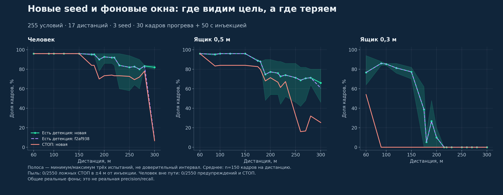

# Проверка обобщения — 18 октября 2026

Кандидат `3344421` сравнен с замороженным `f2af938` в облачном установленном ROS-образе с native-ядром. [Запуск CI](https://github.com/EhimenNathan/tunnelguard-lct2026/actions/runs/39089859458). Последующие изменения запуска, GUI, маркеров и ограничения clear_distance не меняют правила обнаружения этого теста.

## Протокол и результат

[Протокол](protocol.json) зафиксирован до получения результатов: 5 воздействий × 17 дистанций × 3 seed = **255 испытаний на версию**, 20 400 обработанных и 12 750 оцениваемых кадров. На испытание — 30 кадров прогрева и 50 с инъекцией. Новые seed: 104729, 130363, 155921. Фоновые окна выбираются из заранее заданного списка так, чтобы реальный человек не находился рядом с инъекцией. Сопоставление использует известную систему координат инъекции: ошибка дальности <4 м, боковая ошибка <0,8 м. Состояние детектора очищается между испытаниями.

| Воздействие | Кадров с целью | Детекция f2af938 → кандидат | СТОП f2af938 → кандидат |
|---|---:|---:|---:|
| Человек | 2550 | 2186 → **2297** | 1966 → 1966 |
| Ящик 0,5 м | 2550 | 2060 → **2068** | 1578 → 1577 |
| Ящик 0,3 м | 2550 | 731 → 731 | 81 → 81 |
| Пыль | 2550 | 0 → 0 препятствий | 0 → 0 ложных СТОП |
| Человек вне пути, y=3,5 м | 2550 | 0 → 0 предупреждений | 0 → 0 СТОП |

Положительные совпадения: **4977/7650 → 5096/7650** (65,06% → 66,61%; +119 кадров). Все семь заранее установленных [проверок](holdout_gates.json) пройдены; ни одно положительное испытание не потеряло совпадений. Один кадр СТОП у ящика стал предупреждением; улучшение предупреждений не является улучшением всех СТОП.

Для пыли «ложный СТОП» проверяется в окрестности инъекции **±4 м по дальности**, с любой боковой координатой (`near_stop`), а не во всей сцене с существующими реальными объектами. Предупреждений в этой окрестности также **0/2550**. Информационная dust-zone в **±5 м** отмечена в **2302/2550** кадрах (**90,27%**, включая задержку подтверждения); отсутствие флага в остальных 248 кадрах не является FN классификатора твёрдых препятствий. Человек вне пути сопоставляется по указанным выше ограничениям дальности и боковой координаты. Нули относятся к инъецированной отрицательной цели, не ко всем неизвестным объектам фоновой записи.

Человек на 300 м: **123/150 кадров с предупреждением (82%)**, **10/150 со СТОП (6,67%)**. По отдельным seed детекция 42/50, 40/50, 41/50; СТОП 10/50, 0/50, 0/50. Ящик 0,5 м на 300 м: 99/150 детекция, 38/150 СТОП. Ящик 0,3 м на 250–300 м не обнаружен в этих испытаниях. Пропуски включают время подтверждения, недостаточные возвраты и ограничения геометрии.

Это синтетические цели в общих реальных фонах Falcon, не независимые реальные тоннели. Коррелированные кадры не дают оснований строить биномиальный доверительный интервал. После просмотра эти испытания нельзя повторно называть нетронутым holdout для новых настроек. Нулевые ложные сигналы относятся только к перечисленным отрицательным условиям; реальная FP/FN требует разметки организаторов.

## Движение и кривые

[Исходный результат](moving_curves.json), генератор `tools/finals_moving_curves.py`: аналитический тоннель, поезд 5 м/с, 80 кадров 10 Гц, первые 30 — прогрев. Радиусы: прямая, ±800, ±500 м. Угловые ячейки 0,12° оставляют ближайший возврат, приближая окклюзию. Это геометрический стресс-тест, не откалиброванный цифровой двойник LiDAR.

| Путь | Кадры с детекцией / 50 | СТОП / 50 |
|---|---:|---:|
| Прямая | 50 | 50 |
| +800 м | 50 | 50 |
| −800 м | 50 | 50 |
| +500 м | 39 | 36 |
| −500 м | 36 | 33 |

Пустые сцены: **0 препятствий и 0 СТОП в 250 оцениваемых кадрах**. Геометрия валидна во всех 500 оцениваемых кадрах; p95 ошибки оси на 50 м ≤1,70 см. Положительные сцены: 225/250 совпадений, 219/250 СТОП; 225/241 совпадений среди кадров с ≥3 видимыми возвратами. Обе версии дают одинаковый результат: расширение предупреждений не решает окклюзию на крутых поворотах.

Сохранён и [старый статический тест](static_curves.json): на кривых есть провалы обнаружения ящика на 120 м, а R=300 м при разрежении даёт дополнительные пропуски. Протокол статического теста отличается от движущегося; его результаты не заменяются более удачными сценариями. Следующие шаги — анализ видимости и меток каждого пропуска, затем новые независимые сценарии.
