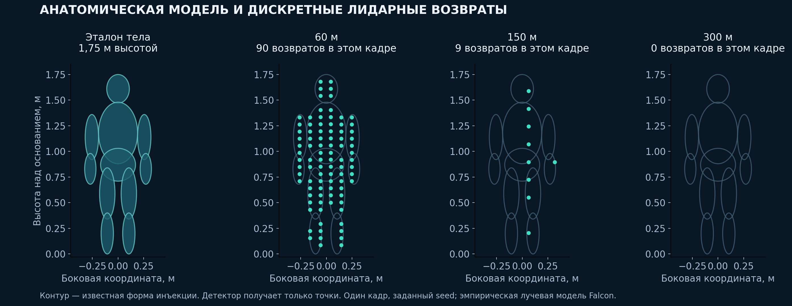

# Дополнительная проверка перед подачей, 20 октября 2026

## Что добавили организаторы

Публичная папка содержит `new_synth_data_with_markers.zst`, 2 533 631 921 байт, SHA-256 `04d176b49526e5da55a0481cf92d8442604dc0fb9f69c31680482b21d8682760`, и [текст сценария](obstacles_organizers.md). Архив загружен и распакован только в GitHub Actions. [Успешный native-прогон 39342143068](https://github.com/EhimenNathan/tunnelguard-lct2026/actions/runs/39342143068) обработал все **1667 кадров**. Хеши 14 модулей ядра совпадают с принятой моделью 404f3c8 / поставкой cdb39de.

Темы: `/lidar_points` и `/synthetic_obstacle_markers` (`visualization_msgs/MarkerArray`). Экспортированы **32135 записей** ADD/DELETE. Активная геометрия — LINE_LIST, локальные вершины нужно сначала повернуть quaternion, затем перенести в pose.position. Одинаковый namespace `synthetic_obstacles`, пустой `text`: явных id-класс меток нет. Нельзя считать DELETE или маркер пыли детекцией алгоритма.

`obstacles.md` подтверждает пыль, человека, малые кубы, кабель, крупный куб 2×2×2 м и балку. Он задаёт порядок, но не точные временные интервалы видимости/пересечения габарита. Старое напоминание о запросе отсутствующих аннотаций отменено после сообщения пользователя об отказе организаторов.

## Анатомическая инъекция

Прежняя 68-условная лестница использовала прямоугольный прокси человека **0,5×0,3×1,75 м**. Учебный генератор в `core/synth.py` отдельно использует цилиндры. Эти тесты не переименованы в анатомические и не пересчитаны задним числом.

Новый независимый по форме диагностический инструмент моделирует голову, торс, таз, руки и ноги как объединение эллипсоидов высотой 1,75 м. Луч попадает в ближайшую поверхность; реальные точки за телом удаляются по пересечению силуэта. Частота лучей и вероятность возврата остаются эмпирической моделью Falcon. Человек не должен выглядеть плотной фотографией на 300 м: в среднем получается около одного отражения на кадр. Контур тела в иллюстрации — эталон, детектор его не получает.

51 условие: 17 заданных дистанций, внутри пути и ±3,5 м от центра снаружи. 30 кадров прогрева +50 оцениваемых. Один seed на дальность, фон выбирается без реального человека рядом с инъекцией. Положение вне пути: y=3,85 и −3,15 м при центре y=0,35. Совпадение по дальности ±4 м и поперечному отклонению <0,8 м. Это **Windows NumPy/Numba**, не native-бенчмарк и не независимая реальная точность. Веса, пороги и исходники принятого детектора не изменялись.

| Дальность | Совпадение | СТОП | Средние возвраты |
|---:|---:|---:|---:|
| 60 м | 48/50 | 48/50 | 85.32 |
| 90 м | 48/50 | 48/50 | 36.76 |
| 100 м | 48/50 | 48/50 | 31.46 |
| 120 м | 48/50 | 48/50 | 20.98 |
| 150 м | 48/50 | 45/50 | 13.04 |
| 175 м | 48/50 | 42/50 | 9.72 |
| 180 м | 48/50 | 42/50 | 9.24 |
| 190 м | 48/50 | 42/50 | 8.08 |
| 200 м | 48/50 | 42/50 | 6.78 |
| 215 м | 48/50 | 42/50 | 6.14 |
| 220 м | 46/50 | 40/50 | 5.76 |
| 230 м | 44/50 | 40/50 | 5.02 |
| 250 м | 47/50 | 42/50 | 3.74 |
| 260 м | 44/50 | 41/50 | 2.74 |
| 270 м | 45/50 | 41/50 | 2.24 |
| 280 м | 37/50 | 33/50 | 1.68 |
| 300 м | 8/50 | 0/50 | 1.06 |

Вне пути: **0/1700** совпадений и СТОП в двух боковых контролях. Человек на 300 м: **8/50** предупреждений, **0/50 СТОП**, в среднем **1,06** возврата. Это существенная выявленная слабость, а не доказательство универсальной дальности. Общие фоны, один seed и эмпирический сенсор ограничивают обобщение. [Все 51 условия](human_anatomy/summary.json).

## Что означают совпадения с маркерами

Геометрическое сопоставление — дополнительная диагностика. Группы человека/кабеля/куба/балки сопоставлены по размерам частей и описанию сценария, а не по отсутствующим официальным id-классам. Первый вариант использует расстояние центроида до AABB ≤0,5 м; второй — запас 4 м вдоль, 0,8 м поперёк и 0,5 м по высоте. [Строгий вариант](organizer_markers/association_strict.json), [аудит допуска](organizer_markers/association_tolerance_audit.json).

В этой диагностике первое совпадение группы человека в платформенной синтетике — около **114,6 м**; кабеля — **119,5 м**; куба 2 м — **156,6 м**; балки — **76,3 м**. Это другие сцены/сенсор и другой протокол, чем реальный Falcon 256,56 м. Они не подтверждают универсальную дальность 258 м. Число помеченных кадров включает цели вне видимого/оценённого габарита, поэтому его дополнение до 100% не является готовым FN. Полный FP/час также нельзя получить простым вычитанием: часть фоновых объектов не размечена.

## Пыль и конкурентный следующий шаг

Система задумана так, чтобы рассеяние оставалось информационным и не давало СТОП. Зафиксированный тест пыли: 0/2550 нежелательных СТОП в ±4 м. Это не обещание нулевого FP на новых сценах. Новые геометрические маркеры позволяют отдельно проверять совпадения выходов с частицами и твёрдыми целями.

Для редких малых целей приоритет — накопление с компенсацией движения, нескольких фаз лучей и неопределённости; одинаковые отрицательные пылевые и рельсовые сцены обязательны. Для кривых — несколько гипотез пути, совместная связь пары рельсов, проверка стрелок и смены кривизны, ограничение дальней экстраполяции. Ослабление СТОП-порогов без этих контролей перед подачей не принято. На аналитических ±500 м прежние пропуски сохранены в отчётах.

Поставляемая версия остаётся закреплённой и проверенной: [Docker](https://github.com/EhimenNathan/tunnelguard-lct2026/actions/runs/39205365593), [pull/Compose](https://github.com/EhimenNathan/tunnelguard-lct2026/actions/runs/39341798129). Три раза 301/301, 46 native-тестов, 12/12 операций управления. [Запуск на ПК](../../RUN_ON_PC_RU.md).
