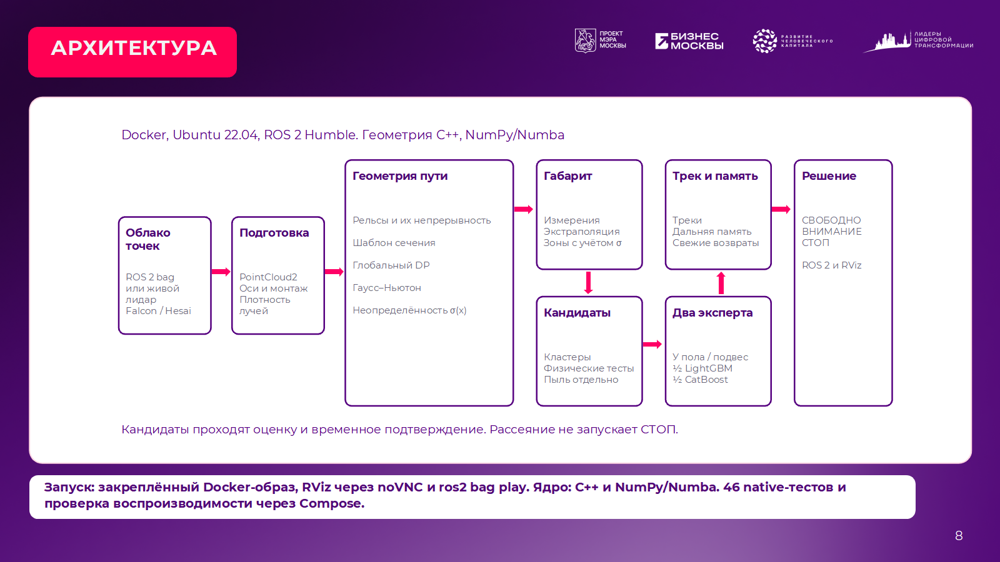
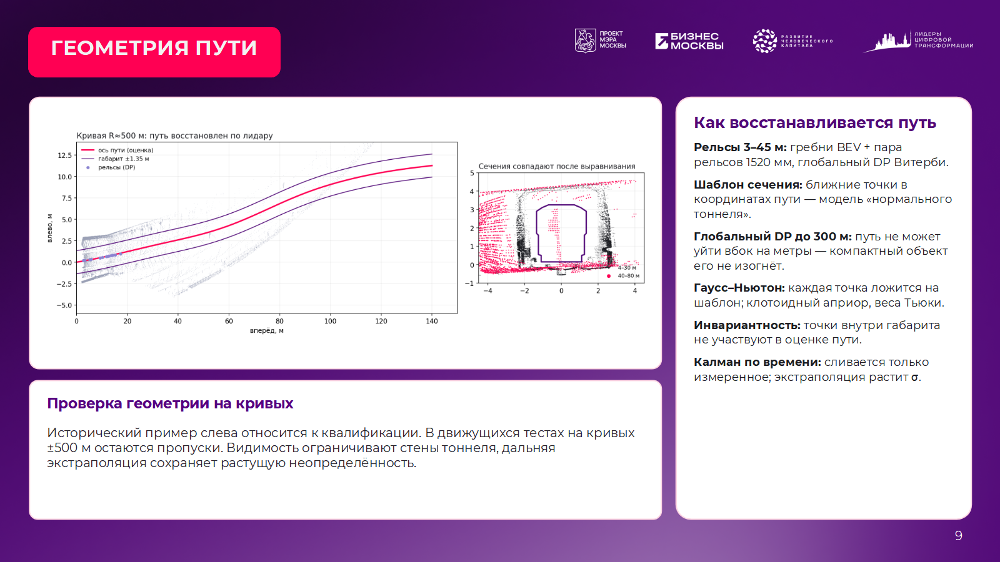
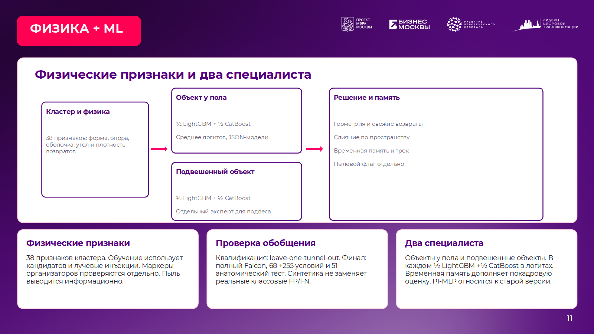

# Финальная презентация команды «СахалИИн»

Пара для подачи: **PPTX и PDF с суффиксом `_Подача`**, 23 слайда. Оба файла содержат обязательные шаблонные слайды 7–11 на позициях **1–5**, как допускают правила организаторов. Формат, оформление, логотипы, фотографии и контакты сохранены из уже заполненной квалификационной версии. Текст решения обновлён результатами финала. Квалификационная презентация `../TunnelGuard_LCT2026.pptx` сохранена отдельно.

Во время выступления можно перейти к слайду 6, а обязательные 1–5 оставить в отправляемых файлах. Финальный слайд содержит действующие ссылки. Нативные диаграммы на слайдах 13 и 16 и таблицы 14, 15, 18 редактируются в PowerPoint. Подробные источники указаны в заметках слайдов и [отчёте](../../docs/finals/submission_20261020/RESULTS_RU.md).

[Сайт финала](https://ehimennathan.github.io/tunnelguard-lct2026/) · [Видео 7:20 при 1×](https://ehimennathan.github.io/tunnelguard-lct2026/#film) · [Сайт квалификации](https://ehimennathan.github.io/tunnelguard-lct2026/qualification.html) · [Запуск на другом ПК](../../docs/RUN_ON_PC_RU.md)

## Проверка файлов

Открыто 23 слайда в Microsoft PowerPoint; из него экспортированы PDF и превью каждого слайда. Проверены все превью; пакет, геометрия макета и 2 диаграммы с вложенными данными прошли структурную проверку. Версия v2 восстановила порядок квалификации: 7 — идея, 8 — архитектура, 9 — геометрия, 10 — габарит, 11 — физика + ML. Диаграммы 8 и 11 редактируются. SHA-256 пары — в [manifest.json](manifest.json). Пустого шаблона вместо заполненных обязательных слайдов нет.

`build_finals.mjs` — фактический источник редактирования через `@oai/artifact-tool`. Он читает квалификационный PPTX и опубликованные JSON/PNG из этого репозитория; промежуточная сборка — `outputs/presentation_build`. Для редактирования презентации нужен отдельный JavaScript runtime с этой библиотекой; он **не требуется** для запуска детектора или открытия готовых PPTX/PDF. Финальный пакет дополнительно проверен встроенным валидатором, а PDF сформирован в Microsoft PowerPoint. Исходный PPTX квалификации использует Montserrat; для точного редактирования установите этот шрифт из официального репозитория JulietaUla/Montserrat.

## Как повторить новые диагностические проверки

Из корня репозитория, Python с NumPy и зависимостями детектора:

```bash
python tools/finals_marker_association.py
python tools/finals_marker_tolerance_audit.py
```

Скрипты читают опубликованные `rows.json`/`markers.json`, учитывают quaternion и перенос маркера и создают JSON в текущей папке. Это геометрическая ассоциация, не официальная precision/recall.

Анатомические инъекции требуют кэша полного Falcon и автоматической траектории того же прогона:

```bash
python tools/falcon_cache.py build /data/falcon_test.zst /data/falcon_cache.bin
python tools/finals_human_anatomy_eval.py /data/falcon_cache.bin docs/finals/reference_automatic.json outputs/human_anatomy
```

`truth.json` должен соответствовать формату `tools/falcon_eval.py`: список записей с `k`, `n`, `x`; это автоматическая траектория, не ручная истинная разметка. Использованный набор результатов сохранён в `docs/finals/submission_20261020/human_anatomy`. Windows NumPy/Numba и native результаты не смешиваются. 51 условие: 17 дальностей, внутри и ±3,5 м снаружи, 30 кадров прогрева +50 оцениваемых. Вне пути 0/1700 предупреждений/СТОП; на 300 м внутри 8/50 предупреждений, 0/50 СТОП. Один seed на дальность ограничивает обобщение.

Производственное ядро и пороги перед подачей не изменялись: используется уже проверенная поставка с закреплёнными Docker digest. Это позволяет воспроизводить представленные результаты без незавершённой настройки модели.

## Исправленные слайды 7–11

Порядок и пурпурно-белая композиция соответствуют квалификационной презентации. Архитектура и ML обновлены под текущую поставку. Исторические изображения геометрии и габарита сохранены с пояснением происхождения.






